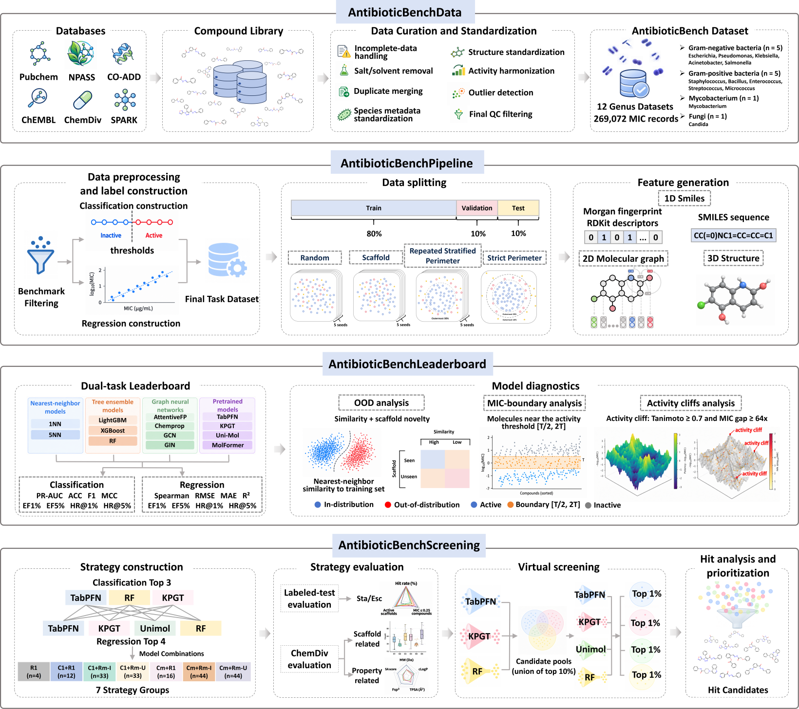

# AntibioticBench

AntibioticBench is an evaluation framework for antimicrobial activity prediction and virtual screening. The associated manuscript describes benchmark datasets for 12 microbial genera and a comparison of molecular machine-learning approaches for activity classification, quantitative prediction, and screening assessment.

## Framework overview



*Figure 1. Overview of the AntibioticBench framework, from the accompanying manuscript.*

AntibioticBench links four parts of the study:

1. **Data curation:** 269,072 compound–genus minimum inhibitory concentration (MIC) records across 12 microbial genera were curated from six sources. Genus-level aggregation combines measurements across strains and assay conditions; classification thresholds are benchmark labels, not clinical susceptibility categories.
2. **Benchmark design:** 13 models are evaluated for activity classification, quantitative MIC prediction, and early enrichment under random, scaffold, repeated stratified perimeter, and strict perimeter splits. The first three use repeated holdout seeds 0–4; strict perimeter uses seed 0.
3. **Performance diagnostics:** nearest-neighbor similarity and scaffold coverage, threshold proximity, and activity cliffs help characterize performance beyond aggregate metrics.
4. **Screening assessment:** classification and regression strategies are compared under matched selection budgets, followed by an exploratory multi-model screening example. The prioritized candidates require experimental validation.

## Repository contents

- [`code/`](code/): research scripts organized by model family: AttentiveFP, Chemprop, GCN, GINE, KPGT, classical machine learning and similarity baselines, MoLFormer, TabPFN, and Uni-Mol. The `GIN` folder contains the GINE scripts.
- [`docs/code.md`](docs/code.md): notes on the supplied scripts, expected input layouts, and their limitations.
- [`data/`](data/): the complete benchmark dataset archive and data provenance information.

## Data availability

Download the complete [benchmark dataset archive](data/AntibioticBench-data.zip), which contains 12 genus-level CSV files. See [`data/README.md`](data/README.md) for extraction, checksums, data provenance, and important limitations.

## Code and reproducibility

The research scripts are provided as-is for reference. **We do not guarantee that they will execute successfully or reproduce the results in the manuscript.** They were developed for specific research environments; individual scripts and their accompanying notes may refer to local paths, external model repositories, pretrained checkpoints, software versions, hardware, schedulers, or precomputed dataset splits that are not included here. Adapt those inputs and environments for your own setup. The model-specific README files are retained as historical documentation, and their commands have not been verified in this repository.

Because of the volume and diversity of the evaluation code, please [open an issue](https://github.com/zhaisilong/AntibioticBench/issues) if you encounter a problem, or contact **zhaisilong@outlook.com**. We will do our best to help.

## Citation

If you use AntibioticBench, please cite the manuscript *AntibioticBench: an evaluation framework for antimicrobial activity prediction and virtual screening*. The following entry is a **placeholder**; author, venue, year, and DOI must be replaced after acceptance.

```bibtex
@article{AntibioticBench,
  title   = {AntibioticBench: an evaluation framework for antimicrobial activity prediction and virtual screening},
  author  = {TBD},
  journal = {TBD},
  year    = {TBD},
  doi     = {TBD}
}
```

## License

The project-authored code and documentation are available for noncommercial academic research and teaching under the [Academic Noncommercial License](LICENSE). Commercial use and other uses outside that license require prior authorization; contact **zhaisilong@outlook.com**. Third-party software, models, checkpoints, and data remain subject to their own terms. The project license does not grant rights to third-party data.
